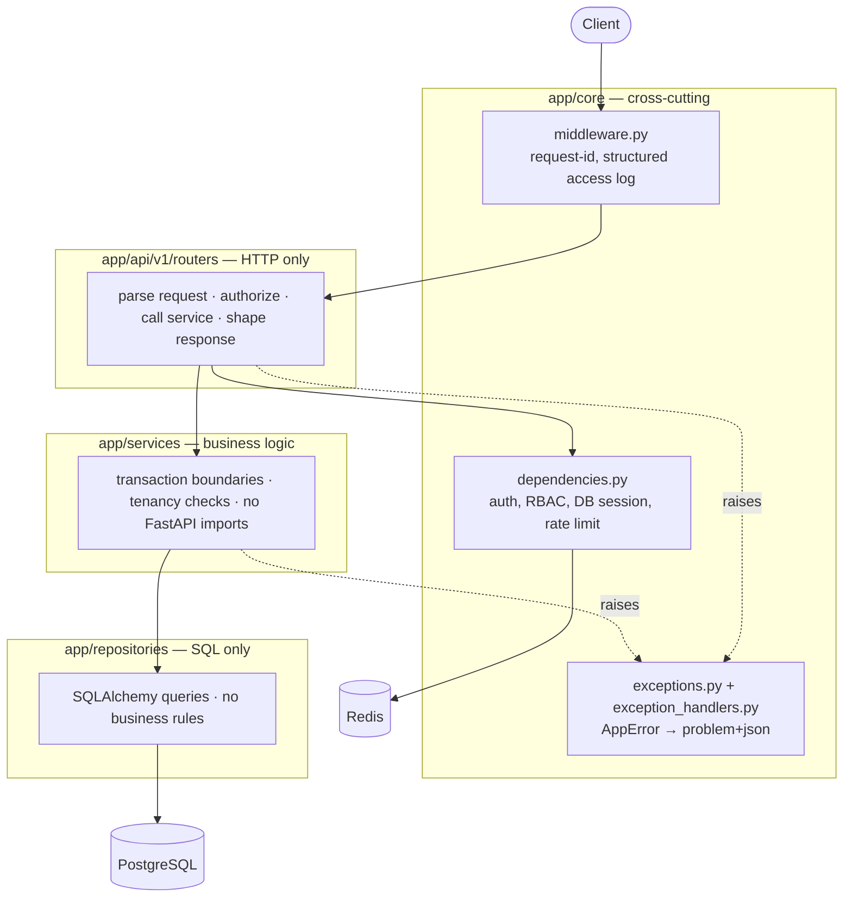
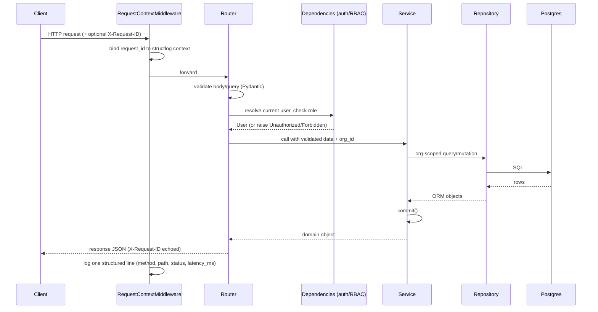
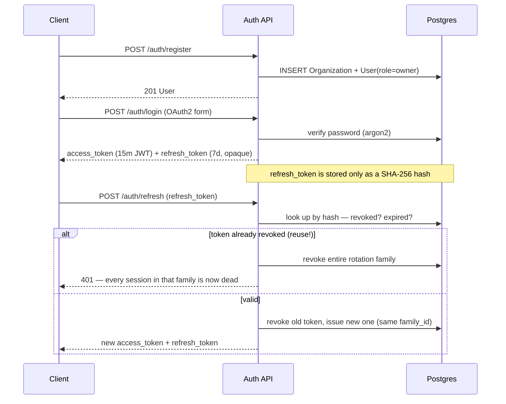

# fastapi-production-starter

A reference-quality, production-grade FastAPI service: a multi-tenant **Task
Board API** (`Organization → User → Project → Task → Comment`). The domain
is deliberately small — the point of this repo is to demonstrate how a real
backend is built: layered architecture, real tenancy isolation, JWT auth
with refresh-token rotation and reuse detection, RFC 9457 error responses,
structured logging, and a test suite that runs against a real Postgres, not
a SQLite stand-in.

## 60-second quickstart

```bash
git clone <this-repo>
cd fastapi-production-starter
cp .env.example .env          # generate a real JWT_SECRET_KEY, see the file's comments
docker compose up --build
```

That's it — Postgres, Redis, migrations, and the API all come up together.
Once the `api` container reports healthy:

```bash
curl http://localhost:8000/health/live
# {"status":"ok"}

make seed   # believable demo data via Faker — prints login credentials

curl -X POST http://localhost:8000/api/v1/auth/login \
  -d "username=owner1@example.com&password=demo-password-123"
```

Interactive docs: http://localhost:8000/docs

## Architecture

Strict layering, enforced by convention (not tooling, see
[Design decisions](#design-decisions-and-trade-offs)): **routers never
import repositories**, and **services never import FastAPI**.



| Layer | Responsibility | Never does |
|---|---|---|
| `api/v1/routers` | Parse the HTTP request, run RBAC, call a service, shape the response | Write SQL, hold business rules |
| `schemas` | Pydantic request/response models, decoupled from the ORM | Touch the database |
| `services` | Business logic, transaction boundaries (`commit()` lives here) | Import `fastapi` |
| `repositories` | SQLAlchemy 2.0 async queries, always org-scoped | Contain business rules |
| `models` | SQLAlchemy ORM — the source of truth for the schema | Import anything above it |
| `core` | Config, security, logging, errors, DI | Depend on any router |

## Request lifecycle



Every error — from a service raising `NotFoundError` down to an unmatched
route or an unhandled exception — is caught by a **single** exception
handler and rendered as `application/problem+json` (RFC 9457), always
carrying the same `trace_id` that went out on `X-Request-ID`. No endpoint
ever leaks a raw 500 or a stack trace.

## Auth flow

OAuth2 password flow. `POST /auth/register` creates a brand-new
organization and its first user as `owner` — there's no separate
"create org" step or invite flow in scope.



Reuse detection is the interesting part: every refresh token belongs to a
`family_id`. Refreshing revokes the presented token and issues a new one
*in the same family*. If a revoked token is ever presented again — meaning
someone has a copy of a token that was already used — that's a strong
signal of theft, so the **entire family** is revoked, not just that token.
See `AuthService.refresh` in `app/services/auth_service.py`.

Email verification and password reset are real, working flows, but sit
behind an `EmailSender` interface (`app/services/email_sender.py`) with a
console-logging implementation — swap in SES/Postmark/etc. by implementing
one method.

## RBAC

Three roles, each including the permissions of the ones below it:
`member` < `admin` < `owner`. Enforced via a FastAPI dependency factory,
`require_role(minimum_role)` (`app/core/dependencies.py`), plus one
business-rule check that isn't expressible as a static role gate: deleting
a comment requires being either its author or an `admin`+.

| Action | Minimum role |
|---|---|
| Read projects/tasks/comments | `member` |
| Create/update tasks, add comments | `member` |
| Create/update/delete projects | `admin` |
| Delete tasks | `admin` |
| Delete a comment | author, or `admin` |

## Tenancy isolation

Every tenant-owned table (`projects`, `tasks`, `comments`) carries its own
`organization_id` column, denormalized rather than reached through a join
chain — every repository query filters on it directly. There's an
integration test (`tests/integration/test_repositories.py`) and an e2e test
(`tests/e2e/test_domain_endpoints.py::test_tenancy_isolation_across_orgs`)
that both prove org B gets a `404` (never a `403` — existence itself isn't
revealed) for org A's resources.

## Testing strategy

54 tests, **89% coverage** on `app/` (`make coverage` for the current
number and the HTML report).

| Layer | What it hits | Real dependencies? |
|---|---|---|
| `tests/unit/` | Pure logic — RBAC ranking, exception handlers | None |
| `tests/integration/` | Repositories and services directly | Real Postgres via **testcontainers** |
| `tests/e2e/` | Full HTTP stack — routers, DI, middleware | Real Postgres (testcontainers) + Redis |

- **No SQLite fakes.** Integration and e2e tests spin up a real
  `postgres:16-alpine` container per test session via
  [testcontainers-python](https://testcontainers-python.readthedocs.io/),
  apply the actual Alembic migrations (catching real migration bugs — see
  below), then wrap each test in a transaction that's rolled back
  afterward, even if the code under test calls `commit()` (via
  `join_transaction_mode="create_savepoint"`).
- **e2e tests hit real HTTP.** `tests/e2e/conftest.py` overrides FastAPI's
  `get_db` dependency to point at the per-test session, and (where needed)
  `get_email_sender` to a capturing test double so the password-reset and
  email-verification flows can be tested end-to-end without a real mail
  provider.
- **RBAC permission matrix**: `tests/unit/test_rbac.py` parametrizes all
  nine (role × minimum-role) combinations. `tests/e2e/test_domain_endpoints.py`
  covers the same matrix through real HTTP calls.
- **Auth lifecycle**: register → login → refresh → reuse-detection → logout
  → change-password (which revokes existing sessions) — all exercised
  end-to-end in `tests/e2e/test_auth_flow.py`.
- **422 shape**: `tests/e2e/test_error_handling.py` asserts the field-level
  error shape, not just the status code.
- **Rate limiting**: an automated test drives the login endpoint past its
  limit and asserts the `429` + `Retry-After` header, not just a manual
  curl check.

Run them:

```bash
make test                                   # everything
make coverage                               # + HTML report at htmlcov/index.html
uv run pytest tests/unit                    # fast, no Docker needed
uv run pytest -m "integration or e2e"       # needs Docker (testcontainers)
```

## Design decisions and trade-offs

- **UUID primary keys, not sequential IDs.** Avoids leaking cross-tenant
  row counts/creation order. Trade-off: slightly larger indexes than `bigint`.
- **`organization_id` denormalized onto every child table**, instead of
  only living on the top-level resource. Makes every tenancy check a single
  indexed `WHERE`, no joins required — at the cost of one extra column and
  the discipline to always set it correctly on insert (enforced in the
  service layer, not the database).
- **Refresh tokens are opaque + hashed, not JWTs.** Access tokens are
  short-lived JWTs (stateless, cheap to verify). Refresh tokens are random
  strings, stored only as a SHA-256 hash — a JWT here would be pointless,
  since revocation/rotation requires a database row to compare against
  anyway.
- **Postgres native enums for `status`/`priority`/`role`**, not
  string+CHECK. Cheaper storage, and the database itself rejects an invalid
  value. Trade-off, learned the hard way while writing the migration: a
  native enum type isn't dropped when its table is — the migration's
  `downgrade()` has to drop the type explicitly, or a later `upgrade()`
  collides on `CREATE TYPE`.
- **A hand-rolled `AppError` hierarchy instead of raising
  `HTTPException` from services.** Keeps services importable and testable
  without FastAPI on the path — verified directly by the "services never
  import fastapi" rule. One exception handler in `app/main.py` maps every
  `AppError` (plus routing-level `HTTPException`, plus
  `RequestValidationError`, plus anything unhandled) to the same RFC 9457
  shape.
- **`extra="ignore"` on `Settings`, not `"forbid"`.** Originally set to
  `"forbid"` for a stricter fail-fast story, but pydantic-settings' `.env`
  loader validates the *whole file* against the model — including keys like
  `POSTGRES_HOST_PORT` that exist only for docker-compose's own variable
  substitution, not the app. Fail-fast should catch *missing* required
  config, not reject unrelated neighbors sharing the file.
- **Host ports 5433/6380, not 5432/6379.** This machine's dev environment
  already had a native Postgres/Redis running on the standard ports —
  `docker-compose.yml` remaps the host side only; containers still talk to
  each other over 5432/6379 internally, via explicit `environment:` overrides
  on the `api`/`migrate` services so they're immune to whatever `.env` says.
- **Cursor pagination is keyset-based** (`created_at`, `id`), not
  offset/limit — stable under concurrent inserts, and doesn't degrade on
  large offsets. Trade-off: no "jump to page 6" — only forward paging.
- **Registration always creates a new organization**; there's no
  invite/join-existing-org flow. Keeping the auth surface small was a
  deliberate scope call — RBAC tests that need multiple roles in one org
  insert users directly via the repository layer in test setup rather than
  through a non-existent invite endpoint.

## What I'd add for real production

- An **invite/membership flow** so a second person can join an existing
  organization instead of every registration minting a new one.
- **Structured audit log** for permission-sensitive actions (role changes,
  deletions) — today's structured logs cover requests, not a durable audit
  trail.
- **Idempotency keys** on the mutating endpoints, so a client retry after a
  network blip can't double-create a task.
- **A real email provider** behind `EmailSender` (SES/Postmark), plus
  actual HTML templates instead of a plaintext token in a log line.
- **OpenTelemetry tracing**, not just structured logs + Prometheus metrics
  — useful once there's more than one service to correlate across.
- **Read replicas / connection routing** if traffic ever justified it; the
  current single-engine setup is the right choice at this scale.
- **Soft deletes** for tasks/projects (audit + "oops" recovery) instead of
  hard `DELETE`.

## Development

```bash
make up          # docker compose up --build
make down         # docker compose down -v
make test         # pytest (unit + integration + e2e)
make coverage      # pytest --cov, HTML report
make lint          # ruff check + ruff format --check + mypy
make fmt           # ruff check --fix + ruff format
make migrate       # alembic upgrade head
make revision m="add foo"   # alembic revision --autogenerate
make seed          # Faker demo data (safe to re-run — no-ops if data exists)
make openapi       # regenerate openapi.json (CI fails the build if this drifts)
```

`.env.example` documents every setting; the app fails fast at startup if a
required one (no default) is missing.

## CI/CD

`.github/workflows/ci.yml` runs on every push/PR to `main`:

1. **lint** — ruff (check + format) and mypy `--strict` on `app/`
2. **test** — matrix across Python 3.11 and 3.12, real Postgres + Redis
   services, coverage uploaded as an artifact, OpenAPI schema drift-checked
   against the committed `openapi.json`
3. **build** — multi-stage Docker build via buildx; pushes to
   `ghcr.io/<owner>/fastapi-production-starter` tagged `:sha` and `:latest`
   on `main` only
4. **security** — `pip-audit` against the resolved dependency set, plus a
   Trivy scan of the built image (fails on CRITICAL/HIGH)

Dependabot (`.github/dependabot.yml`) watches `uv`, GitHub Actions, and the
Dockerfile weekly.

### Branch protection

This repo doesn't configure branch protection itself (that's a repo
setting, not something in code). To require the CI checks above before
merging to `main`: **Settings → Branches → Add branch protection rule** for
`main`, enable "Require status checks to pass before merging", and select
the `lint`, `test`, `build`, and `security` jobs. Enabling "Require branches
to be up to date before merging" is also recommended so stale PRs re-run CI
against the latest `main`.

## Stack

Python 3.12 · FastAPI · Pydantic v2 · SQLAlchemy 2.0 (async) + asyncpg ·
Alembic · PostgreSQL 16 · Redis · Argon2 (`passlib`) · PyJWT · structlog ·
`uv` · pytest + testcontainers · ruff + mypy (strict) · Docker · GitHub
Actions.
